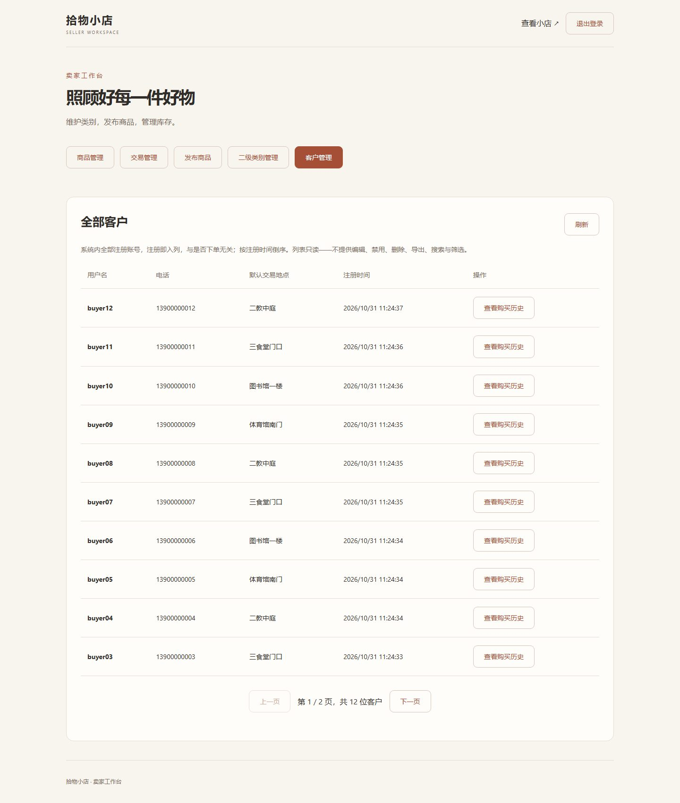
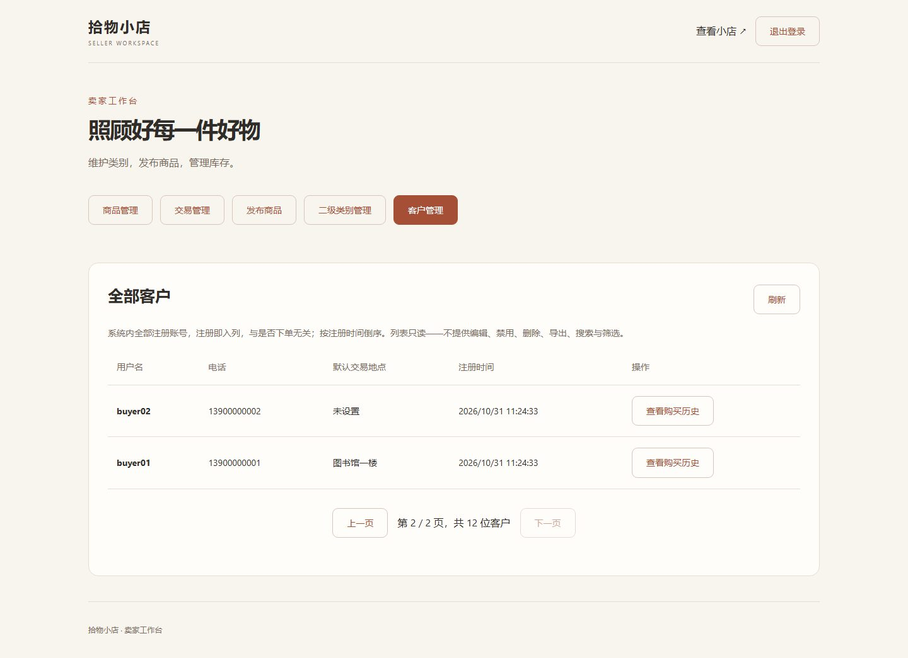
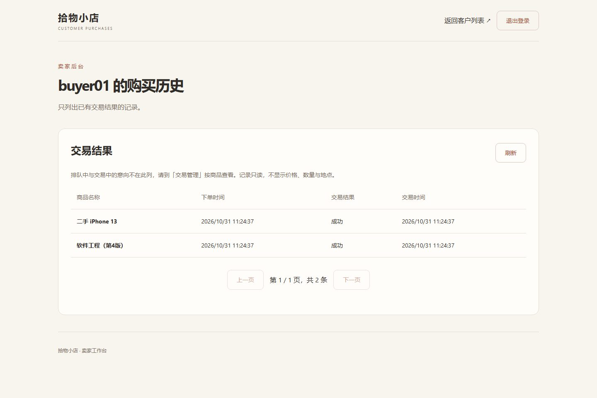
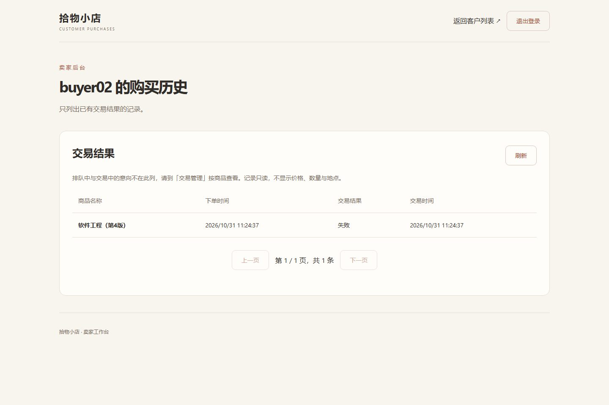
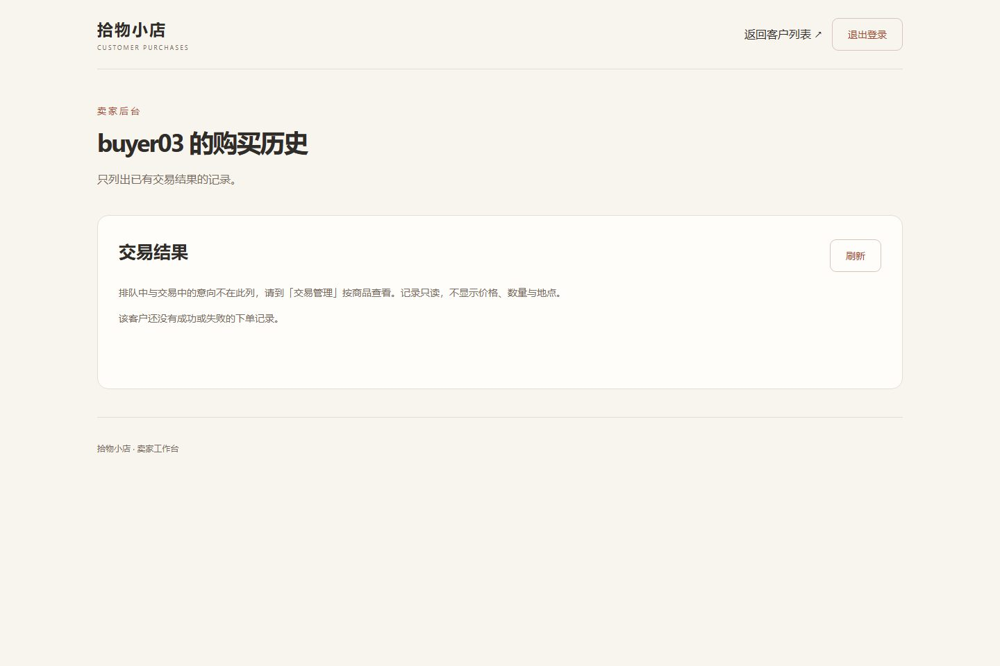
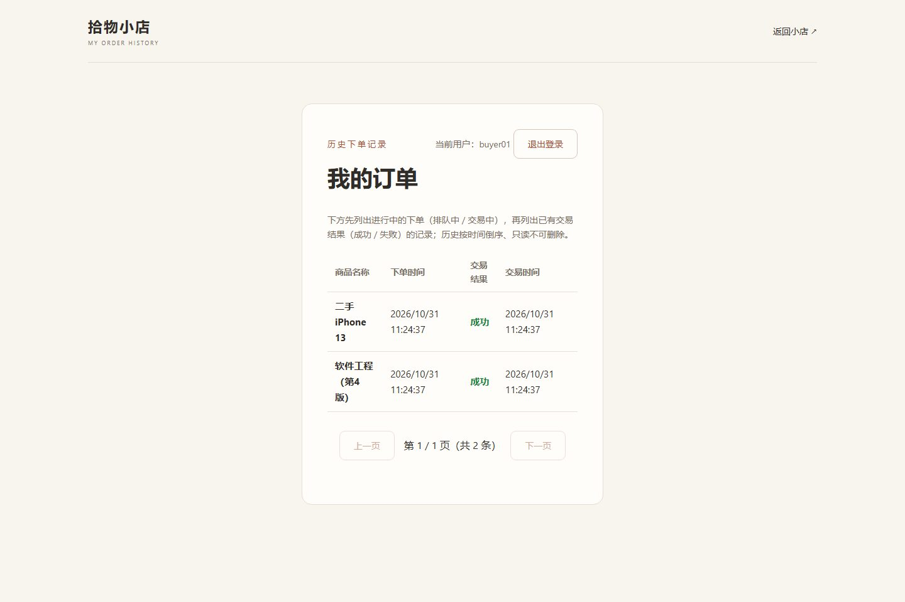
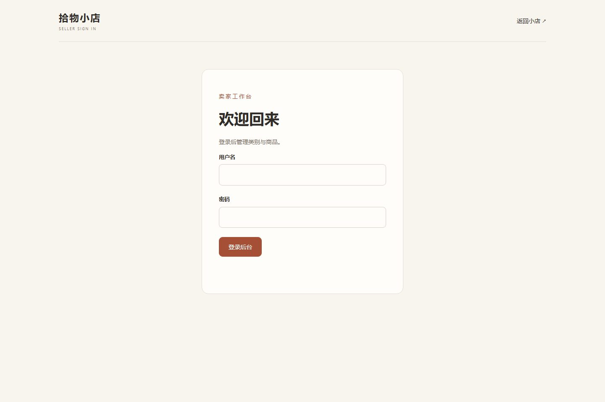
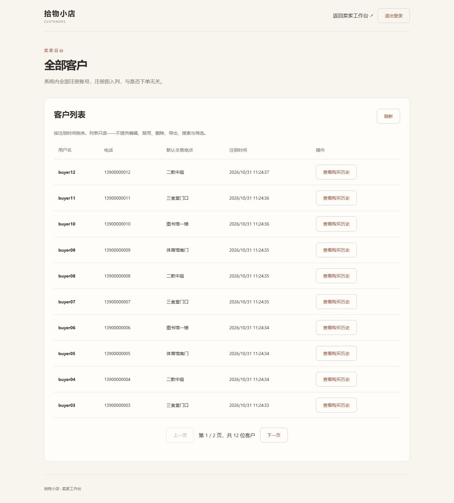

# 页面截图索引

9 张图对应客户管理模块（FR-S-13 / FR-S-14）的 9 个自检场景，均来自本地隔离环境（端口 3100，独立 SQLite 文件 `target/demo/shop.db`）的真实浏览器截图。演示数据为临时数据，不使用正式库。

[打开离线截图画册](截图画册.html)

## 01_后台客户管理列表第一页

后台页签栏「客户管理」高亮；列表显示 10 行，四列字段；翻页显示"第 1 / 2 页，共 12 位客户"

## 02_客户列表第二页_默认交易地点未设置

第二页显示 buyer02 与 buyer01；buyer02 注册时未填默认交易地点，显示"未设置"

## 03_购买历史_成功两条

从客户列表点「查看购买历史」进入 buyer01 的历史页：2 条记录均为"成功"，含下单时间与交易时间

## 04_购买历史_失败一条

buyer02 的购买历史：1 条"失败"记录；只列已终结交易

## 05_购买历史为空_仅排队中

buyer03 只有一笔排队中的意向，未进入交易，历史页显示空态提示

## 06_买家端我的订单对照

buyer01 自己登录买家端"我的订单"：同样 2 条成功记录，商品名、时间与 03 一一对应（与卖家端一致）

## 07_未登录访问客户列表跳转登录

未登录直接打开 `/customers.html`，自动跳转到卖家登录页

## 08_未登录访问购买历史跳转登录

未登录直接打开 `/customer-purchases.html?id=1`，同样跳转到登录页

## 09_客户列表独立页_已登录

已登录时直接访问独立页 `/customers.html`，与后台「客户管理」页签共用同一组接口

