# 页面截图索引

12 张图对应 12 个禅道任务，均来自本地隔离环境（`SHOP_PORT=3100`，数据落在独立 SQLite 文件）的真实浏览器截图。演示数据为临时数据，不使用正式库。

[打开离线截图画册](截图画册.html)

## 01_未登录详情无下单入口

未登录打开商品详情：只有"登录后提交购买意向"，没有任何可用下单入口

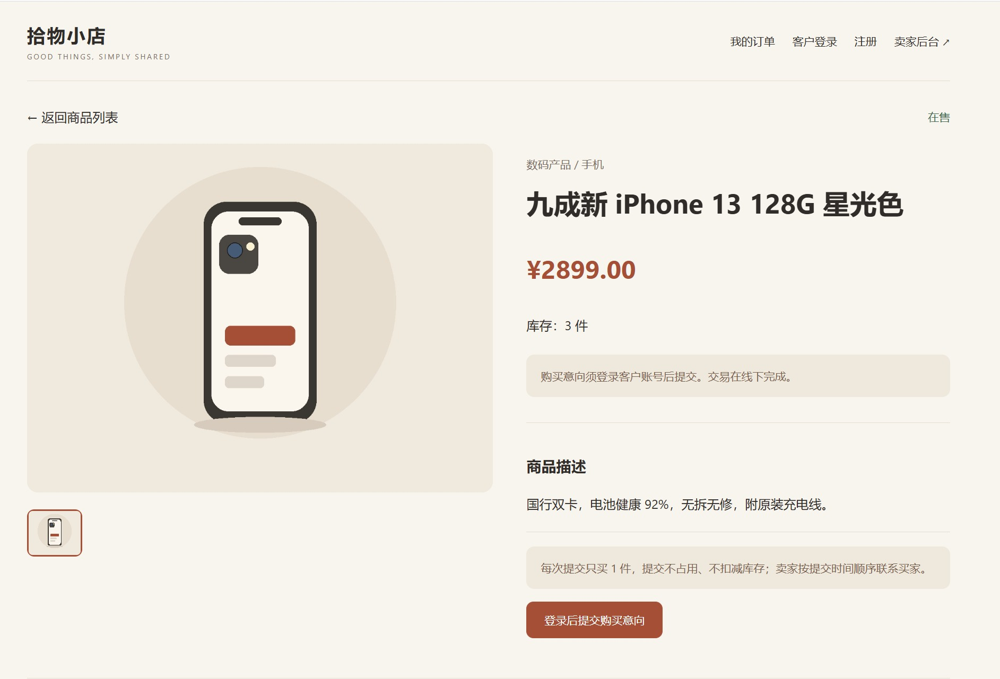

## 02_登录后提交成功排队位次

客户登录后提交成功，提示当前排在第 1 位，且库存仍为 3 件

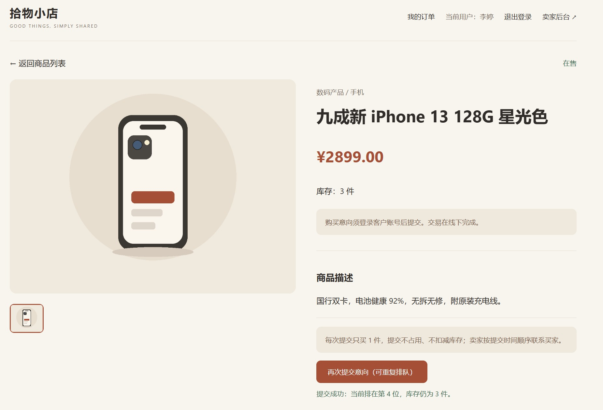

## 03_我的订单进行中两条记录

同一账号连续提交 2 次，"我的订单"出现 2 条独立记录，位次按时间排序

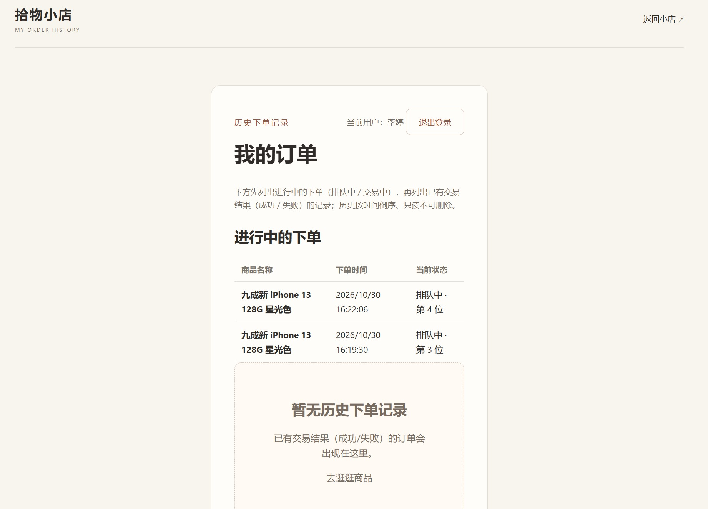

## 04_后台交易管理队列

后台交易管理显示队列 3 人，队首、第 2 位、第 3 位与提交时间一一对应

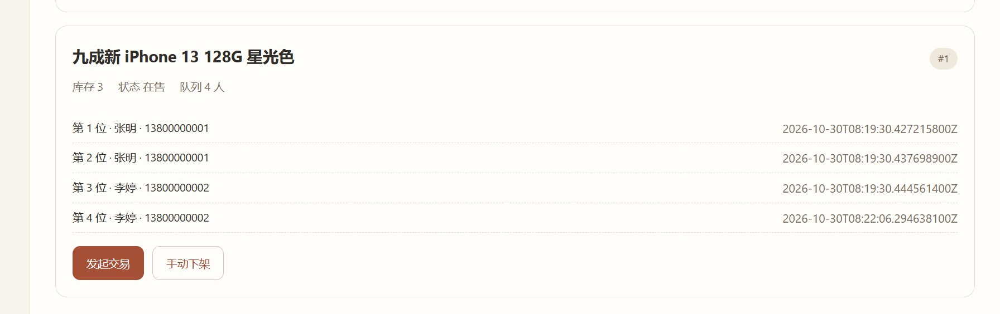

## 05_发起交易后列表不可见

发起交易后商品被冻结，买家端列表与搜索结果中不再出现该商品

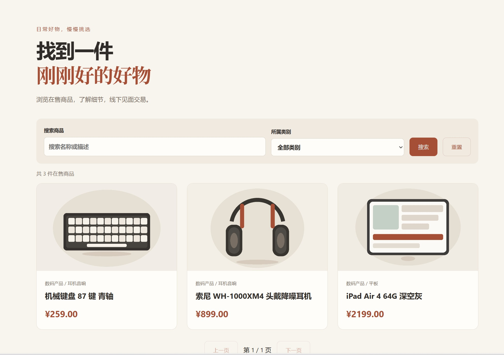

## 06_冻结商品直链只读

冻结商品通过直链打开仍可只读查看，但提交按钮置灰、接口返回 409

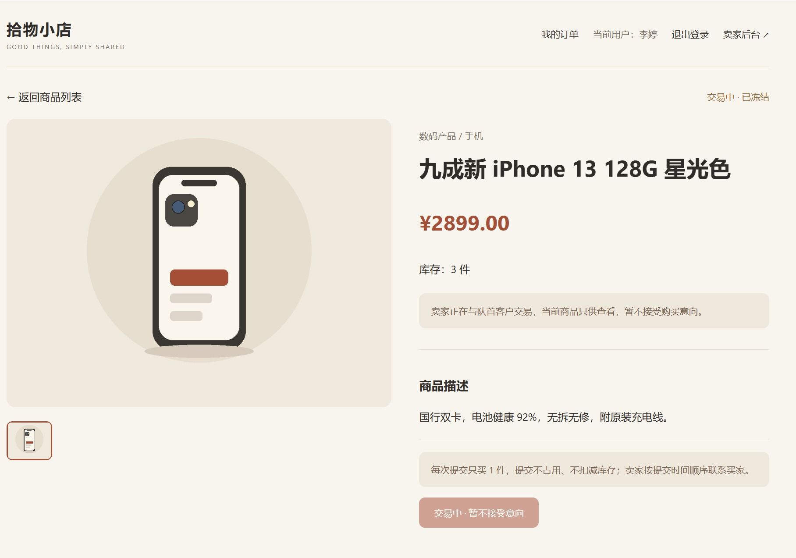

## 07_标记成功库存减一

标记交易成功后库存由 3 变为 2，商品回到在售，其余同客户意向作废

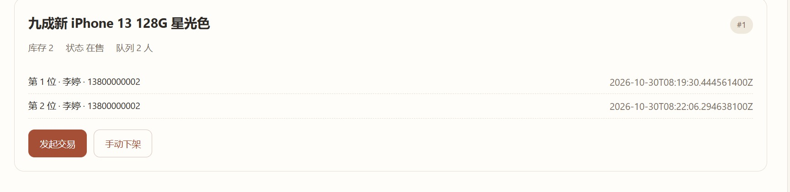

## 08_库存归零已售终态

库存 1 成交 1 单后库存归零，商品进入"已售（终态）"，并出现在历史商品

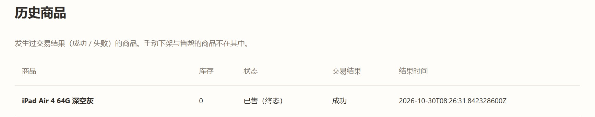

## 09_失败重新排队到队尾

标记失败选择重新排队后，该客户排到队尾、下单时间刷新为重排时间

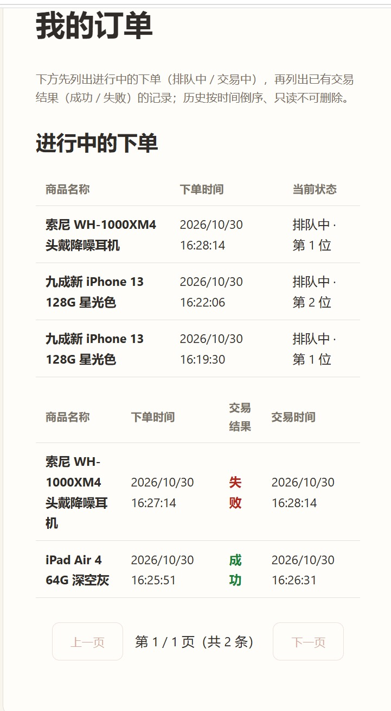

## 10_手动下架买家端无法访问

手动下架后买家端检索不到，直链详情返回 404

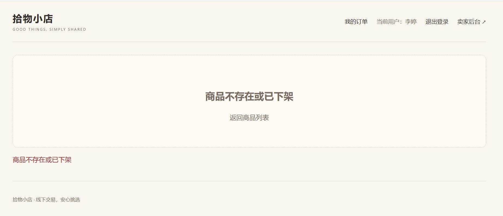

## 11_售罄补货仍为下架

库存调 0 自动售罄；补货 3 件后状态仍为"售罄下架"，买家端仍不可见

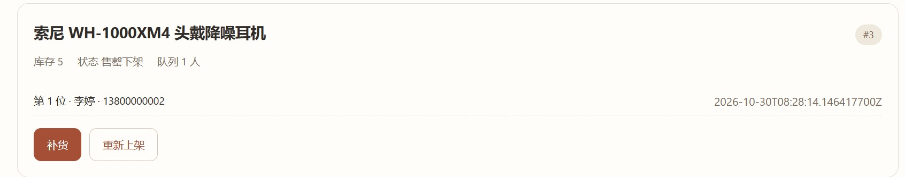

## 12_重新上架恢复在售

点击重新上架后回到在售、买家端可见可下单，原队列被清空

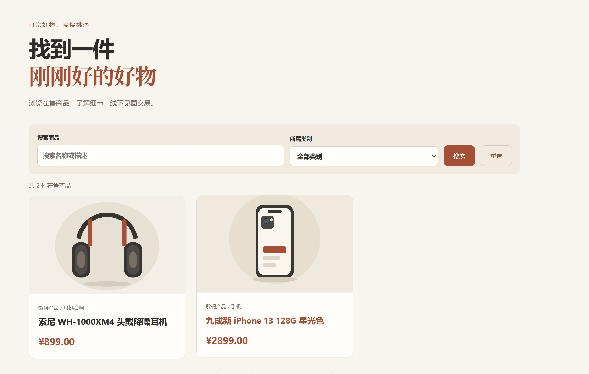

