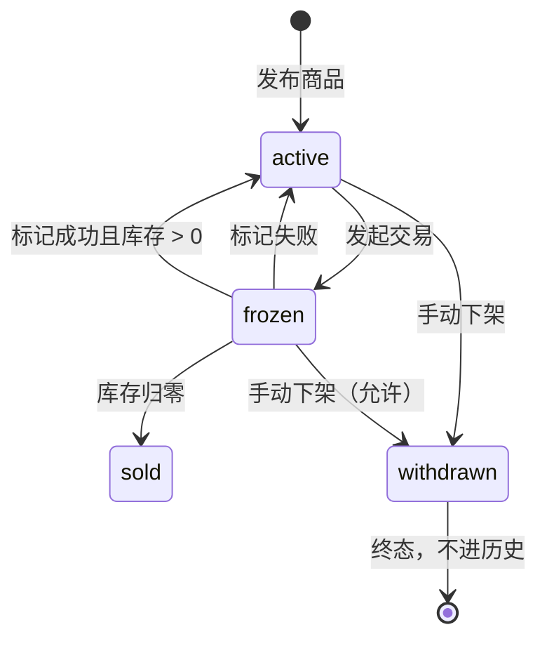
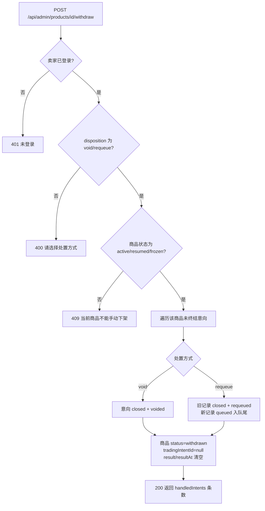

# 22267 手动下架商品 · 设计

| 项 | 内容 |
| --- | --- |
| 禅道任务 | 22267 手动下架商品设计（开发：22268） |
| 迭代 | 第三次报告（V2.0） |
| 作者 | 陈心冉 |
| 日期 | 2026-10-30 |
| 代码位置 | `src/main/java/com/coursewise/shopping/trade/TradeService.java` `withdraw()`；`TradeController` `POST /api/admin/products/{id}/withdraw` |

## 1. 需求与目标

卖家需要随时把商品从货架上撤下来（包括正在交易的），以便灵活控制上架商品。

- 在售、已冻结商品都可手动下架；库存为 0 的商品由系统自动下架（`depleted`），不需要手动下架。
- 下架后买家端立即不可见：检索不到、详情打不开、不能提交意向。
- 下架时若有未终结意向（排队中 + 交易中），必须由卖家逐条选择处置方式：作废 / 重新排队。
- 手动下架是终态：不进历史商品列表，也没有重新上架入口。

## 2. 与既有状态的边界

系统原有状态里最容易混淆的是"冻结"与"下架"，本次明确区分：

| 状态 | 含义 | 买家端可见 | 可恢复 |
| --- | --- | --- | --- |
| `active` / `resumed` | 在售 | 可见、可下单 | — |
| `frozen` | 交易中或暂缓（本次由发起交易自动进入） | 详情可读、列表不可见、不可下单 | 标记成功/失败后自动恢复 |
| `sold` | 成交后库存归零，终态 | 不可见 | 否，补货也不恢复 |
| `depleted` | 库存归零自动下架（售罄） | 不可见 | 补货 + 重新上架可恢复（22269/22270） |
| `withdrawn` | **手动下架，本次新增使用** | 不可见 | **否**，无重新上架路径 |

> `withdrawn` 枚举在商品模块升级时已随 `ProductStatus` 定义，但一直没有业务入口；本次把"手动下架"接上，并明确它是终态。

## 3. 状态机

## 4. 处理流程

关键点：

1. **先处置意向再改状态**，避免出现"商品已下架但队列里还挂着 active 意向"的中间态。
2. **清空 `result` / `resultAt`**：历史商品列表以 `result != null` 为口径，清空保证手动下架商品绝不进历史。
3. 允许对 `frozen` 商品下架——需求明确"已冻结商品下架不被阻止"，此时正在交易的那位买家也按同一规则处置。

## 5. 接口

`POST /api/admin/products/{id}/withdraw`（需 `seller_session`）

请求：`{"disposition": "void"}` 或 `{"disposition": "requeue"}`

| 场景 | 状态码 | 响应 |
| --- | --- | --- |
| 成功 | 200 | `{"ok":true,"status":"withdrawn","handledIntents":2}` |
| 未登录 | 401 | `{"error":"未登录"}` |
| 处置方式非法 | 400 | `{"error":"请对未终结意向选择作废或重新排队"}` |
| 商品状态不允许 | 409 | `{"error":"当前商品不能手动下架"}` |

## 6. 数据变更

无表结构变更。`product.status` 复用既有 `withdrawn` 取值，`trading_intent_id` 置空，`result`/`result_at` 置空。

## 7. 验收对照

| 验收标准 | 实现方式 | 回归结果 |
| --- | --- | --- |
| 在售商品下架后买家端立即检索不到、详情不可访问 | 列表 SQL 只取 `active/resumed`；`detail()` 对非可售且非冻结状态抛 404 | 通过（列表 total=0，详情 404） |
| 已冻结商品下架不被阻止 | 允许 `frozen` | 通过 |
| 下架时要求卖家对未终结意向选择作废/重新排队 | `disposition` 必填，缺省 400 | 通过 |
| 手动下架的商品不出现在历史商品列表 | 清空 `result`，历史以 `result != null` 查询 | 通过 |
| 该商品无"上架/重新上架"按钮 | 前端只对 `depleted` 渲染重新上架按钮 | 通过 |

## 8. 遗留

- "重新排队"的意向会挂在下架商品上，永远等不到交易。这是按需求"沿用交易失败处置规则"的直接结果；若要彻底解决，需要在下架时提示卖家"该商品不会再上架，是否仍要排队"。
- 下架后图片文件未删除（与商品模块一致，图片保留以便追溯）。
