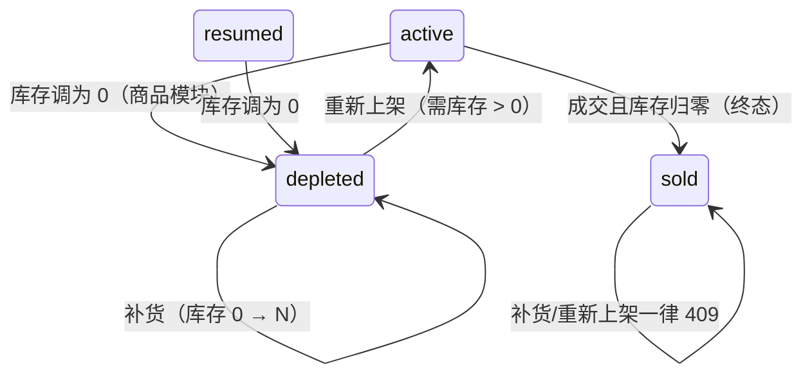
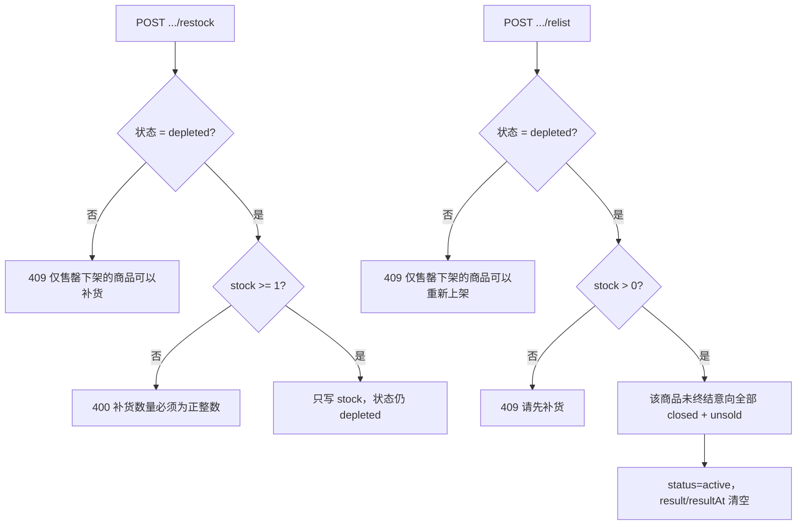

# 22269 售罄补货并重新上架 · 设计

| 项 | 内容 |
| --- | --- |
| 禅道任务 | 22269 售罄补货并重新上架设计（开发：22270） |
| 迭代 | 第三次报告（V2.0） |
| 作者 | 陈心冉 |
| 日期 | 2026-10-30 |
| 代码位置 | `TradeService.restock()` / `TradeService.relist()`；`POST /api/admin/products/{id}/restock`、`POST /api/admin/products/{id}/relist` |

## 1. 需求与目标

卖家的同一件货可能不止一份。库存卖光后（未成交就归零）商品自动下架，此时卖家补货并把它重新上架，商品就能恢复销售。

- 仅适用于**售罄下架**（`depleted`）的商品。
- **交易成功下架（`sold`）为终态，不适用**：那是"这件商品已经卖掉了"，不是"暂时没货"。
- 库存由 0 调为正数后，商品**仍为已下架**，必须再执行"重新上架"才回到在售。
- 重新上架后重新接收意向；**原队列不恢复**；系统不通知买家。

## 2. 为什么拆成"补货"和"重新上架"两步

这是本设计最需要解释的取舍——需求明确要求两步分离，但初学者容易合并成一个"补货并上架"按钮。分开的三个理由：

1. **卖家要能先备货、后开卖**。补货是仓库动作（可能分批到货），上架是运营动作；合并后卖家一改库存就被动上架，来不及调价/改描述/换图。
2. **避免误操作**：把库存误填成 3 就直接开卖，商品带着旧队列的期望值暴露给买家。
3. **可审计**：`restock` 只写库存，`relist` 只写状态，两次操作在后台都有明确提示，便于排查"为什么商品又出现了"。

## 3. 售罄（`depleted`）是怎么产生的

由商品模块的"编辑库存"触发：库存从 >0 改成 0 时，`CatalogService.edit()` 把商品状态置为 `depleted` 并记录 `resultAt`。本次不改该逻辑，只在交易侧接管它之后的恢复路径。

## 4. 处理流程

### 队列处理（"原队列不恢复"的落地方式）

重新上架时，把该商品所有 `stage != closed` 的意向统一置为 `closed + unsold`（在客户历史里显示"失败"），队列长度归零。这样做的原因：

- 售罄期间买家已经等了很久，商品重新上架时不应让旧买家"插队复活"；
- 旧意向的 `submittedAt` 早于重新上架时间，若恢复会立刻成为队首，卖家一发起交易就对上一位早已放弃的买家。

## 5. 接口

| 接口 | 请求 | 成功响应 | 主要错误 |
| --- | --- | --- | --- |
| `POST /api/admin/products/{id}/restock` | `{"stock": 3}` | `{"ok":true,"stock":3,"status":"depleted"}` | 409 非售罄商品；400 数量非法 |
| `POST /api/admin/products/{id}/relist` | 无 | `{"ok":true,"status":"active","clearedIntents":2}` | 409 非售罄商品；409 库存为 0 |

两个接口都要求 `seller_session`，未登录 401。

## 6. 数据变更

无表结构变更。仅写 `product.stock`、`product.status`、`product.result`、`product.result_at`；意向侧只写 `stage` / `outcome` / `closed_at`。

## 7. 验收对照

| 验收标准 | 实现 | 回归结果 |
| --- | --- | --- |
| 售罄商品库存改 3 后仍为已下架、买家端不可见 | `restock` 不改 status；列表只取 `active/resumed` 且 `stock>0` | 通过 |
| 重新上架后回到在售、买家端可见可下单 | `relist` 置 `active` | 通过（列表 total 1，可再次下单 201） |
| 重新上架后意向队列为空，旧意向不恢复 | 未终结意向全部 `unsold` | 通过（queueCount=0） |
| 已售商品无重新上架入口，调高库存也不回在售 | `sold` 状态两个接口都返回 409；前端只对 `depleted` 渲染按钮 | 通过 |

## 8. 遗留

- 售罄与手动下架的区别只在"是否可恢复"：`depleted` 可补货恢复，`withdrawn` 不可。后台需要靠状态文案区分，建议后续在列表里加"可恢复/不可恢复"标签。
- 补货不记录补货次数与时间，若需要"补货流水"需新增 `restock_log` 表。
