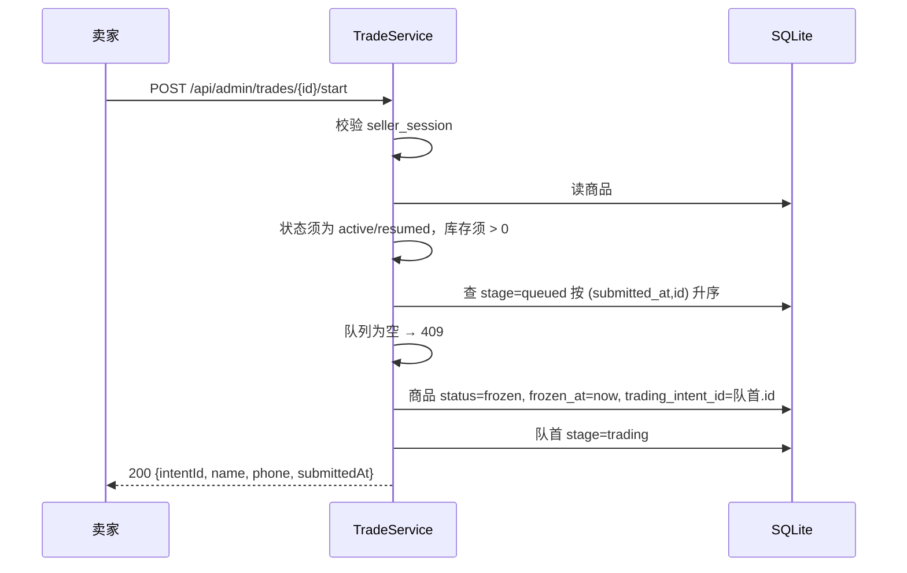

# 22271 发起交易 · 设计

| 项 | 内容 |
| --- | --- |
| 禅道任务 | 22271 发起交易设计（开发：22272） |
| 迭代 | 第三次报告（V2.0） |
| 作者 | 陈心冉 |
| 代码位置 | `TradeService.startTrade()`；`POST /api/admin/trades/{id}/start` |

## 1. 需求与目标

卖家在后台点"发起交易"，系统自动锁定队首买家，卖家去线下和这个人交接。

- **卖家主动发起**，系统**强制取队首**（最早提交且未终结）——一次只对一人、只卖 1 件，**不能挑选**。
- 发起后商品**自动冻结**，停止接受新意向；冻结只锁这一件商品，不影响其他商品。
- **本版不提供手动冻结/解冻**；想中止本次交易只能"标记交易失败"。

## 2. 队列口径（设计的核心）

队列顺序由 `(submitted_at, id)` 升序决定，不落库位次：

```sql
SELECT * FROM intent
WHERE product_id = ? AND stage = 'queued'
ORDER BY submitted_at ASC, id ASC
```

- `submitted_at` 是 ISO-8601 字符串，字典序与时间序一致，可直接用于 `ORDER BY`；
- 同一毫秒并发提交时用自增 `id` 兜底，**保证不出现并列第一**；
- 位次 = 该结果里当前意向的下标 + 1，实时计算（不缓存），因此有人撤销/作废后位次自动前移。

**"强制取队首"的实现方式**：接口不接受 `intentId` 参数，服务端自己取 `queued.get(0)`。这样即使前端被篡改也选不了别人——这是需求"无法选择其他位次"的唯一可靠实现。

## 3. 状态与流程



## 4. 并发控制

`TradeService` 用一把公平锁 `ReentrantLock(true)` 包住 `TransactionTemplate`，锁在**事务提交之后**才释放（`write()` 的 `try/finally` 在 `transaction.execute` 之外）。这样"读队列 → 改状态 → 提交"整体串行，避免两个后台标签页同时点"发起交易"把同一个人锁两次。

对比：旧版单商品实现用 `@Transactional + synchronized`，锁在方法返回时就释放，事务还没提交，理论上存在窗口；本次统一改成"锁包事务"。

## 5. 接口

`POST /api/admin/trades/{id}/start`（需 `seller_session`，无请求体）

| 场景 | 状态码 | 响应 |
| --- | --- | --- |
| 成功 | 200 | `{"productId":1,"intentId":3,"name":"buyer2","phone":"138...","submittedAt":"..."}` |
| 未登录 | 401 | `{"error":"未登录"}` |
| 商品不在可售状态 | 409 | `{"error":"商品当前不能开始交易"}` |
| 库存为 0 | 409 | `{"error":"库存为 0 的商品不能发起交易"}` |
| 队列为空 | 409 | `{"error":"当前没有排队中的购买意向"}` |

## 6. 数据变更

`product.status = 'frozen'`、`product.frozen_at = now()`、`product.trading_intent_id = 队首意图.id`、`intent.stage = 'trading'`。无表结构变更。

## 7. 验收对照

| 验收标准 | 实现 | 回归结果 |
| --- | --- | --- |
| 被选中客户必然是队首，无法选择其他位次 | 接口无 `intentId` 入参，服务端取 `queued.get(0)` | 通过（返回 intentId = 第 1 条） |
| 发起后商品变已冻结，买家端列表与搜索不可见 | 列表查询只取 `active/resumed` | 通过（total=0） |
| 冻结期间其他商品浏览与下单不受影响 | 冻结按 `product_id` 隔离，无全局状态 | 通过（其他商品仍可浏览下单） |
| 后台无独立"冻结/解冻"按钮 | 前端只渲染"发起交易/标记结果"；旧 `/api/admin/freeze` 路由返回 410 | 通过（410） |

## 8. 遗留

- 冻结态详情仍可被"知道链接"的买家只读打开（需求要求"直链只读"），因此详情接口对 `frozen` 放行、对 `sold/withdrawn/depleted` 返回 404。
- 交易发起后没有超时机制，靠卖家主动标记结果；如需超时自动失败，需要定时任务。
