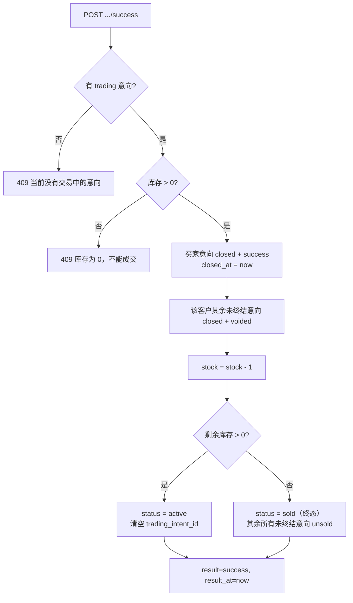

# 22273 标记交易成功 · 设计

| 项 | 内容 |
| --- | --- |
| 禅道任务 | 22273 标记交易成功设计（开发：22274） |
| 迭代 | 第三次报告（V2.0） |
| 作者 | 陈心冉 |
| 代码位置 | `TradeService.markSuccess()`；`POST /api/admin/trades/{id}/success` |

## 1. 需求与目标

线下交割完成后，卖家点"标记交易成功"，系统自动扣减库存并流转商品状态。

- 标记成功时**库存减 1**；减后 **> 0 商品回在售**；**= 0 进入已下架（已售）**，为终态，补货也不重新上架，并进历史商品。
- **不得超卖**：库存为 0 后不能继续成交。
- 该笔意向记为**成功**，**交易时间 = 标记时间**。
- **同一客户**在该商品的其余未终结意向**一并作废**（记失败）。

## 2. 三条规则之间的关系

这三条看似独立，其实是一条链，实现时必须一起想清楚：

| 规则 | 若不这样做的后果 |
| --- | --- |
| 库存 -1 | 库存永远不减，一件商品能被无限次"成交" |
| 同客户其余意向作废 | 同一个买家自己排了 3 次队，买 1 件后还占着 2 个位次，把别人堵死 |
| 库存归零→终态 | 库存 0 却还能被再次发起交易，出现超卖 |

特别注意"同一客户"这个限定：**其他客户的意向不清空**。因为库存可能还剩，商品回到在售时，排在后面的人应当继续排队——这一点和旧版单商品实现（成交即清空全部意向）不同，是本迭代按多库存模型做的调整。

## 3. 状态流转

## 4. "交易时间"的落点

- 买家意向的 `closed_at` = 标记时间；
- 商品的 `result_at` = 标记时间；
- 两者取同一个 `now()` 字符串，避免毫秒级不一致导致对账困难。

客户历史页读的是 `intent.closed_at`，后台历史商品读的是 `product.result_at`，口径一致。

## 5. 接口

`POST /api/admin/trades/{id}/success`（需 `seller_session`，无请求体）

| 场景 | 状态码 | 响应 |
| --- | --- | --- |
| 成功 | 200 | `{"ok":true,"stock":2,"status":"active","resultAt":"..."}` |
| 未登录 | 401 | `{"error":"未登录"}` |
| 无交易中意向 | 409 | `{"error":"当前没有交易中的意向"}` |
| 库存为 0 | 409 | `{"error":"库存为 0，不能成交"}` |

## 6. 数据变更

`intent.stage='closed'`、`intent.outcome='success'/'voided'/'unsold'`、`intent.closed_at`；`product.stock--`、`product.status`、`product.result='success'`、`product.result_at`、`product.trading_intent_id=null`。无表结构变更。

## 7. 验收对照

| 验收标准 | 实现 | 回归结果 |
| --- | --- | --- |
| 库存 3 成交 1 单后库存变 2，商品回在售 | `remaining>0 → active` | 通过（stock 2、active） |
| 库存 1 成交 1 单后库存变 0，商品为已下架（已售）、买家端不可见、进历史商品 | `remaining==0 → sold`，列表排除 `sold`，历史以 `result != null` 查询 | 通过 |
| 已售商品调高库存也不回在售 | `sold` 下补货/上架接口均 409 | 通过 |
| 库存 0 的商品不能再发起新交易 | `startTrade` 校验 `stock > 0` | 通过 |
| 客户历史中该笔显示"成功" | `outcome=success` → `CustomerService.toResult()` 映射"成功" | 通过 |
| 同客户其余未终结意向同批变"失败" | 按 `customerId` 匹配置 `voided` | 通过（客户1 进行中记录清空） |

## 8. 遗留

- 成交金额取商品当前 `price_cents`，未做金额快照。商品价格发布后不可改（商品模块 BR-14），因此暂时安全；若将来允许改价，需要在下单时快照 `dealAmountCents`。
- 成交没有生成"订单号"给买家，客户历史里靠 `intent.id` 标识。
