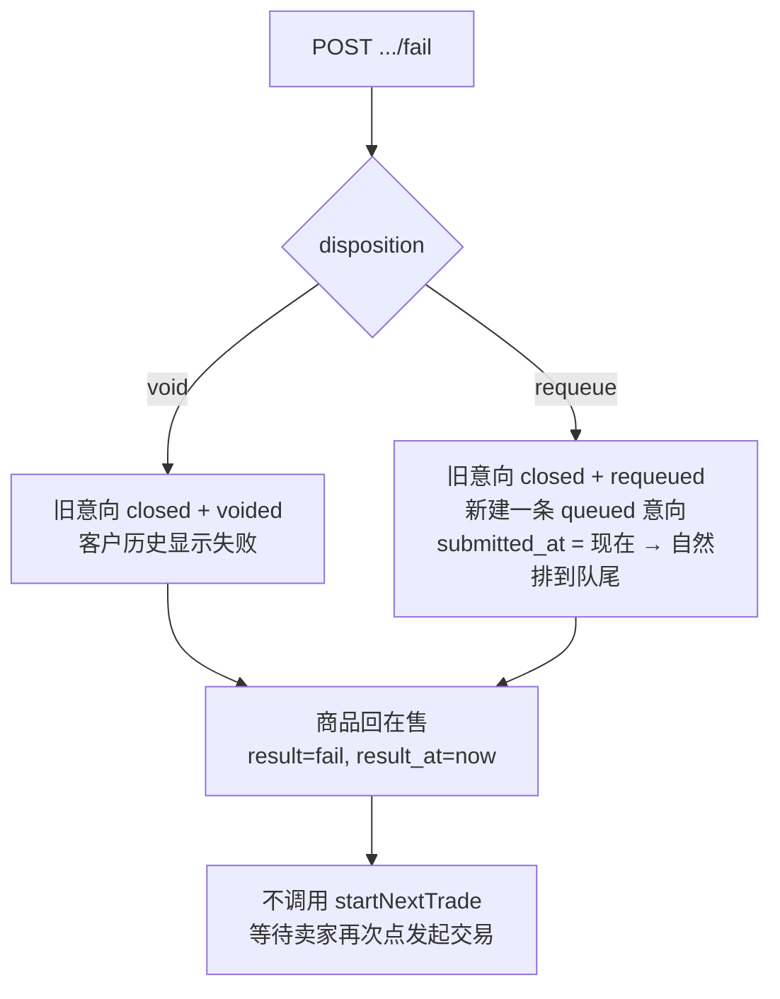
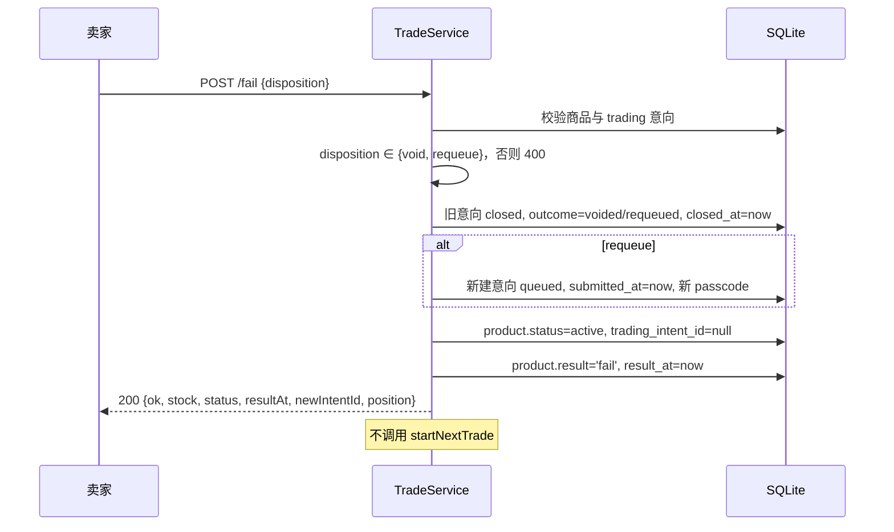

# 22275 标记交易失败 · 设计

| 项 | 内容 |
| --- | --- |
| 禅道任务 | 22275 标记交易失败设计（开发：22276） |
| 迭代 | 第三次报告（V2.0） |
| 作者 | 陈心冉 |
| 代码位置 | `TradeService.markFail()`；`POST /api/admin/trades/{id}/fail` |

## 1. 需求与目标

交易谈不成时，卖家标记失败，并决定该买家是"作废"还是"重新排队"。

- 标记失败后**商品恢复在售**；**不自动递补下一位**进入交易。
- 选"**作废**"：该意向记为失败，进客户历史。
- 选"**重新排队**"：旧记录以失败结案，**新记录排队尾**、下单时间刷新为当前时间。
- 交易失败**不扣减库存**；该商品因发生过交易失败**应计入历史商品**。

## 2. 两种处置的本质区别

| 维度 | 作废（void） | 重新排队（requeue） |
| --- | --- | --- |
| 买家后续 | 彻底出局，需重新下单 | 保留资格，回到队尾 |
| 记录 | 1 条（原记录结案） | 2 条（原记录结案 + 新记录排队） |
| 位次 | 后面的所有人前移 | 该买家排到最后 |
| 历史 | 显示"失败" | 显示"失败" |

**为什么"重新排队"要新建记录而不是改原记录？**
原记录的 `submitted_at` 是买家首次下单时间，是排序依据、不可变（需求分析 §4.2）。直接改时间会破坏历史真实性，且客户历史里那条失败记录会消失。新建记录 + 旧记录结案，两份记录都在，可审计。

**为什么"不自动递补"？**
需求明确要求。卖家刚经历一次失败（可能白跑一趟），系统立刻把下一位锁进交易态，卖家来不及反应，反而容易产生"锁死"的商品。所以标记失败后商品回到 `active`，由卖家再次点"发起交易"。

## 3. 状态流转

## 4. 与"商品进历史"的冲突及解决

需求要求"该商品因发生过交易失败应计入历史商品"，但商品此时仍**在售**，会同时出现在"商品管理"和"历史商品"两个列表里。

解决方式：把"历史商品"的口径从"状态 = 已售"改成"`result` 非空"。

- 成功：`result='success'`，状态 `sold`；
- 失败：`result='fail'`，状态 `active`；
- 手动下架 / 售罄：`result` 为空，不进历史。

这样一条 `result` 字段同时满足三个需求（失败进历史、下架不进历史、售罄不进历史），不必再加"是否上过架"之类的标记。

## 5. 接口

`POST /api/admin/trades/{id}/fail`（需 `seller_session`）

请求：`{"disposition": "void"}` 或 `{"disposition": "requeue"}`

| 场景 | 状态码 | 响应 |
| --- | --- | --- |
| 成功 | 200 | `{"ok":true,"newIntentId":8,"position":1,"stock":2,"status":"active","resultAt":"..."}` |
| 处置方式非法 | 400 | `{"error":"无效的失败处置方式"}` |
| 无交易中意向 | 409 | `{"error":"当前没有交易中的意向"}` |

## 6. 数据变更

`intent.stage/outcome/closed_at`；requeue 时新增一条 `intent`（新 `customer_id/name/phone/passcode/submitted_at`）；`product.status='active'`、`product.result='fail'`、`product.result_at`、`product.trading_intent_id=null`。**不动 `stock`**。

## 7. 验收对照

| 验收标准 | 实现 | 回归结果 |
| --- | --- | --- |
| 标记失败后商品回在售，买家端可见可下单 | `status=active`、`trading_intent_id=null` | 通过 |
| 系统不自动让下一位进入交易，需卖家再次发起 | 不调用递补逻辑 | 通过（status 仍 active，非 frozen） |
| 选"作废"后客户历史该笔记"失败" | `outcome=voided` → 映射"失败" | 通过 |
| 选"重新排队"后该客户排到队尾，下单时间为重排时间 | 新记录 `submitted_at=now`，位次实时计算 | 通过（position=1） |
| 标记失败前后库存不变 | 不写 `stock` | 通过（2 → 2） |
| 该商品出现在历史商品列表 | `result='fail'`，历史按 `result != null` 查询 | 通过 |

## 8. 遗留

- 失败不记录原因（未接电话 / 反悔 / 地址问题），后续若要做卖家复盘，需要加 `fail_reason` 枚举字段。
- 重新排队会生成新口令码（内部字段，界面已不使用口令码），仅用于满足数据库唯一约束。
