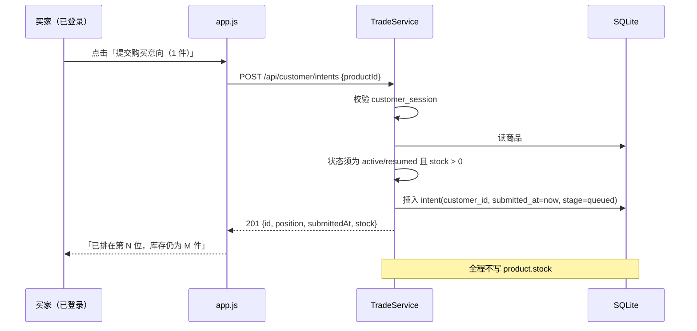
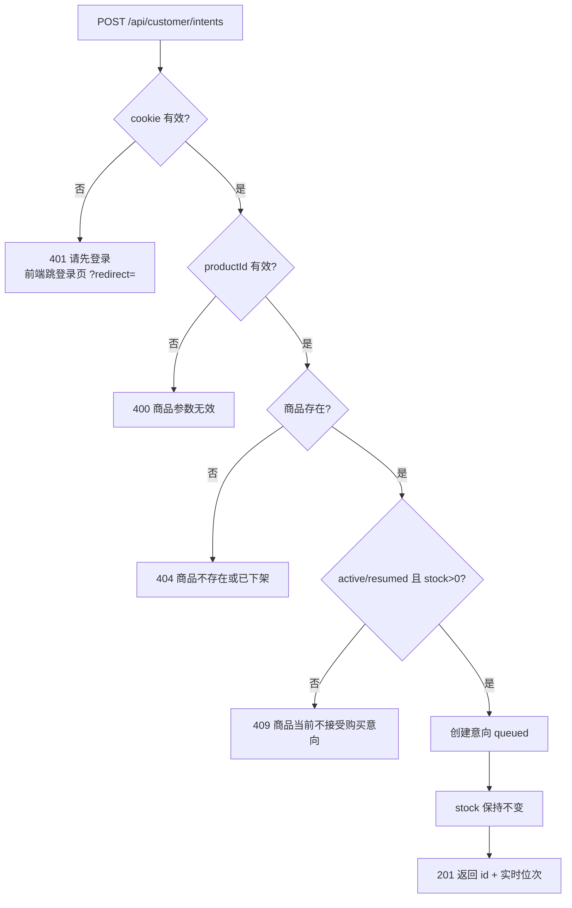

# 22304 提交购买意向 · 设计

| 项 | 内容 |
| --- | --- |
| 禅道任务 | 22304 提交购买意向设计（开发：22303） |
| 迭代 | 第三次报告（V2.0） |
| 作者 | 陈心冉 |
| 代码位置 | `TradeService.submitIntent()`；`POST /api/customer/intents`；前端 `public/app.js` 详情页提交区 |

## 1. 需求与目标

买家在商品详情页提交购买意向，卖家按先来后到与其交易。

| # | 规则 |
| --- | --- |
| R1 | 必须注册登录后才能提交；未登录无任何提交通道（**原口令码入口废除，不得出现在界面**） |
| R2 | 一单固定 1 件；提交成功即生成一条下单记录（挂在账号下，下单时间 = 提交时间） |
| R3 | 意向信息直接取自账号，无修改意向信息入口 |
| R4 | 同一账号对同一商品可重复提交，**不去重**，按提交时间排队 |
| R5 | 提交**不预占、不扣减库存** |
| R6 | **已冻结、已下架**商品不能提交意向 |

## 2. 与 V1 的根本差异

本任务不是"加一个按钮"，而是换掉整套身份与凭证模型。这一点必须在评审时讲清楚，否则会被认为与旧代码重复。

| 维度 | V1（旧单商品版） | V2（本次） |
| --- | --- | --- |
| 身份 | 匿名，买家自填姓名 + 电话 | 登录客户账号，`customer_id` 外键 |
| 凭证 | 8 位口令码，展示一次 | **废除**，界面无任何口令码 |
| 查询进度 | `POST /api/intents/query` 凭口令码 | "我的订单"页，凭登录态 |
| 修改信息 | `PUT /api/intents` | **废除**，账号资料不可改 |
| 鉴权 | 无 | `customer_session` Cookie，未登录 401 |
| 库存 | 无该字段 | 提交只读不写 |

**口令码的清理方式**：后端 `passcode` 字段保留但仅内部生成（数据库 `NOT NULL UNIQUE` 约束要求），**任何接口都不再返回它**；前端彻底删除口令码查询表单。全局搜索 `passcode`，出现在后端实体与生成逻辑中属正常，出现在 `public/` 前端中即为缺陷。

## 3. 数据模型

`intent` 表新增使用 `customer_id`（此前已随客户模块建好，匿名意向为空）：

| 字段 | 说明 |
| --- | --- |
| `customer_id` | 关联 `customer.id`，本次提交必填 |
| `name` / `phone` | 取自账号的用户名与电话（冗余快照，方便后台直接看到联系方式） |
| `submitted_at` | 提交时间，决定排队位次，不可变 |
| `stage` | `queued` / `trading` / `closed` |
| `passcode` | 内部唯一约束用，不对外 |

> 姓名/电话是冗余字段而非实时联表：客户注册后不能改资料（FR-C-08），冗余不会产生不一致，反而让后台列队查询少一次 join。

## 4. 提交流程

## 5. 界面设计

| 状态 | 买家端表现 |
| --- | --- |
| 未登录 | 不渲染提交按钮，只显示"登录后提交购买意向"，点击跳 `/customer-login.html?redirect=当前商品页` |
| 已登录 + 可买 | "提交购买意向（1 件）"，成功后提示"已排在第 N 位，库存仍为 M 件"，按钮变为"再次提交意向" |
| 已登录 + 冻结 | 按钮置灰："交易中 · 暂不接受意向" |
| 已登录 + 下架/售罄 | 按钮置灰："商品已下架 · 不可提交" / "已售罄 · 不可提交" |

**前端置灰只是体验，拦截必须放在后端**：验收标准要求"直链打开冻结商品也无法提交"，因此 `curl` 直接打接口必须拿到 409。

## 6. 接口

`POST /api/customer/intents`（需 `customer_session`）

请求：`{"productId": 3}`

| 场景 | 状态码 | 响应 |
| --- | --- | --- |
| 成功 | 201 | `{"id":12,"productId":3,"submittedAt":"...","position":1,"stock":3}` |
| 未登录 | 401 | `{"error":"未登录"}` |
| 参数非法 | 400 | `{"error":"商品参数无效"}` |
| 商品不存在 | 404 | `{"error":"商品不存在或已下架"}` |
| 冻结/下架/售罄 | 409 | `{"error":"商品当前不接受购买意向"}` |

配套：`GET /api/customer/intents` 返回当前客户"排队中 + 交易中"的记录，供"我的订单"页展示（历史只含终态，FR-C-07）。

## 7. 验收对照

| 验收标准 | 实现 | 回归结果 |
| --- | --- | --- |
| 未登录无可用下单入口，或点击后跳转注册/登录页 | 前端不渲染按钮；后端 401 | 通过（401） |
| 登录后提交成功，立即生成一条下单记录 | 插入 `intent` 并返回 id | 通过（201） |
| 同一账号连续提交 2 次生成 2 条独立记录，队列按时间排序 | 无唯一约束，`submitted_at=now` 每次刷新 | 通过（position 1、2） |
| 提交后商品库存数字不变 | 提交路径不写 `stock` | 通过（3 → 3） |
| 对已冻结商品（直链打开）无法提交意向 | 后端校验状态，非 `active/resumed` 一律 409 | 通过（409） |

## 8. 遗留

- 需求"可重复提交、不去重"意味着单账号可以无限刷队列。当前按需求实现，仅在前端做 300ms 防抖（不改变业务语义）。建议后续产品确认是否限制"同一账号对同一商品最多 N 条有效意向"。
- "一单固定 1 件"通过**不设数量字段**表达；若将来支持多件，需要新增 `quantity` 并改库存扣减逻辑。
- 历史匿名意向（`customer_id` 为空）不进入任何客户的历史记录，仅在后台历史商品里可见。
